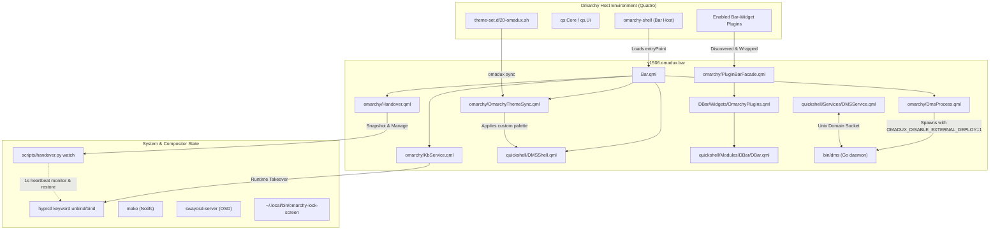

# Omadux (`y1506.omadux.bar`) Implementation Plan

> **For agentic workers:** REQUIRED SUB-SKILL: Use `superpowers:subagent-driven-development` (recommended) or `superpowers:executing-plans` to implement this plan task-by-task. Steps use checkbox (`- [ ]`) syntax for tracking.

**Goal:** Build `omadux` (`y1506.omadux.bar`), an autonomous, zero-destructive, hotswappable Omarchy bar plugin that brings the entire DUX Shell (`dux-shell` + `dms` Go daemon + `DCommon`) into Omarchy's Quattro (`omarchy-shell`) runtime with full theme sync, keybind takeover/restoration, and dual-plugin hosting.

**Architecture:** Runs in-process inside `omarchy-shell` via a validated `Bar.qml` root component. Resolves DUX's internal `import qs.*` collision via automated AST/regex rewriting to relative paths + directory `qmldir` singletons while preserving Omarchy's `qs.Core`/`qs.Ui`. Manages external app config safety via `OMADUX_DISABLE_EXTERNAL_DEPLOY` gating in the vendored Go backend (`core`), and coordinates state snapshots, dynamic `hyprctl` keybind takeovers, lock screen shim, and mako/swayosd handovers with an automated watchdog for 100% clean restoration on exit or disable.

**Tech Stack:** QML / QtQuick / Quickshell, Go 1.27 (`dms` daemon), Python 3 (handover & watchdog), Bash, Hyprland IPC (`hyprctl`), Mako, SwayOSD, TOML/JSON.

**Spec:** Defined in user request prompts, modeled on `caelestia.bar` and `dux-shell` reference architectures.

---

## Global Constraints

- **NO Modifying Hyprland Configs on Disk:** NEVER edit, append, or touch `~/.config/hypr/*.conf` or `~/.local/share/omarchy/default/hypr/*`. All keybind takeovers and visual/blur rules MUST happen dynamically at runtime via `hyprctl keyword` and be 100% restored from a pre-enable snapshot when the plugin is disabled or `omarchy-shell` exits.
- **Safe File Boundaries Only:** Write only to the plugin repository (`/home/y1506/Projects/Omadux`), `~/.config/omarchy/plugins/y1506.omadux.bar/`, `~/.local/share/omarchy/plugins/y1506.omadux.bar/`, `~/.cache/DankMaterialShell/`, `$XDG_RUNTIME_DIR/omadux-handover/`, `~/.local/bin/omadux`, `~/.local/bin/omarchy-lock-screen` (temporary runtime lock shim, created ONLY while lock takeover is active and deleted on disable), and `~/.config/omarchy/hooks/theme-set.d/20-omadux.sh`.
- **External File Deployment Disabled by Default:** Gate all external app config writes in `dms` (`matugen` / `dank16` / `deployer.go`) behind `OMADUX_DISABLE_EXTERNAL_DEPLOY=1` and `enableExternalAppTheming: false` (default `false`) in `SettingsData.qml` / `SettingsSpec.js`.
- **In-Process Quattro Architecture (Option A):** Rewrite DUX's internal `import qs.{Common,Services,DCommon,Widgets,Modals,Modules}` into relative path imports + directory `qmldir` singletons, while preserving `qs.Core` and `qs.Ui` for Omarchy integration.
- **Dev-Only Upgradability:** End-user self-update UI/CLI in DUX is locked/hidden. Provide developer-only `scripts/upstream-check` + `tests/upstream.lock` workflow.
- **Git Workflow (Local Only):** Clean, atomic Git commits on local branches. **NEVER run `git push` or push to any remote repository.**

---

## Review Focus

1. **Hyprland Keybind State Restoration:** If `omarchy-shell` crashes, terminates abruptly, or the plugin is disabled, all original user keybindings must be restored by the detached watchdog without requiring a desktop reboot or leaving orphaned binds.
2. **QML Module Resolution & Namespace Isolation:** Zero unresolved `qs.*` collisions inside DUX components; all singletons (`Theme`, `SettingsData`, `SessionData`, `Paths`, `DMSService`, etc.) must resolve properly without breaking Omarchy's host singletons (`qs.Core`, `qs.Ui`).
3. **No External Config Tampering:** Under no circumstances should `dms` or `matugen` overwrite `~/.config/hypr`, `~/.config/kitty`, `~/.config/ghostty`, or GTK settings when `enableExternalAppTheming` is `false`.
4. **Lock Screen Fallback & PAM Safety:** If `omadux`'s lock surface fails or is unresponsive, `omarchy-lock-screen` shim must immediately fall back to `hyprlock` so the user is never locked out of their session.
5. **Theme & Wallpaper Convergence:** When Omarchy changes theme or wallpaper via `omarchy theme set`, the theme hook `20-omadux.sh` must execute `omadux sync`, generating valid Material 3 / Dank16 color tokens in `~/.cache/DankMaterialShell/omarchy-theme.json` that apply seamlessly without restarting the shell.

---

## Architecture Diagram



---

## File Structure

```text
/home/y1506/Projects/Omadux/
├── manifest.json                 # Omarchy bar plugin manifest (schemaVersion: 1, kinds: ["bar"], entryPoints: {"bar": "Bar.qml"})
├── Bar.qml                       # Quattro root entry point
├── qmldir                        # Root module declarations
├── install.sh                    # Compiles/fetches bin/dms, installs ~/.local/bin/omadux & hook
├── uninstall.sh                  # Restores handovers, stops dms, cleans up bins and hooks
├── omadux.lua                    # Neovim / Omarchy theme colorscheme specification
├── .gitignore
├── bin/
│   └── .gitkeep                  # Compiled `dms` binary (git-ignored)
├── core/                         # Vendored dux-shell/core Go source with deployment guard patch
│   ├── cmd/dms/
│   ├── internal/config/deployer.go
│   └── internal/matugen/matugen.go
├── quickshell/                   # Vendored dux-shell/quickshell tree (rewritten imports & qmldirs)
│   ├── DMSShell.qml              # Embedded root component (non-ShellRoot Item)
│   ├── DMSShellIPC.qml           # IPC router for DUX actions
│   ├── Common/                   # Singletons + qmldir (Theme, SettingsData, SessionData, Paths, etc.)
│   ├── DCommon/                  # Vendored from dux-qml-common/DCommon + qmldir
│   ├── Services/                 # Services + qmldir (DMSService, AudioService, NotificationService, etc.)
│   ├── Widgets/                  # Common widgets + qmldir
│   ├── Modals/                   # DLauncherV2, Settings, Clipboard, PowerMenu, Keybinds, etc.
│   └── Modules/                  # DBar, ControlCenter, DDash, Dock, Lock, Notifications, OSD, etc.
├── omarchy/                      # Omarchy integration layer
│   ├── qmldir
│   ├── DmsProcess.qml            # Supervises `bin/dms run --session` lifecycle
│   ├── Handover.qml              # Orchestrates handover.py snapshot/apply/restore
│   ├── KbService.qml             # Dynamic runtime keybind takeover & routing
│   ├── NotifHandover.qml         # Mako pausing & restore
│   ├── OsdHandover.qml           # SwayOSD pausing & restore
│   ├── LockHandover.qml          # Lock shim coordinator
│   ├── OmarchyThemeSync.qml      # Syncs colors.toml & wallpaper to DUX Theme
│   ├── OmarchyPluginService.qml  # Discovers external Omarchy bar-widget plugins
│   ├── PluginBarFacade.qml       # Omarchy PluginBarApi facade
│   └── BarWidgetSlot.qml         # Hosts Omarchy bar-widget plugins
├── scripts/
│   ├── rewrite-imports.py        # AST/regex transformer for relative imports + qmldir generation
│   ├── handover.py               # Snapshot/apply/restore + background watchdog
│   ├── osd-handover              # SwayOSD takeover helper
│   ├── notif-popups              # Mako takeover helper
│   ├── lock-screen               # Lock screen shim
│   ├── omadux                    # Theme converter (colors.toml -> omarchy-theme.json)
│   └── upstream-check            # Developer verification against upstream commits
└── tests/
    ├── upstream.lock             # Locked commit SHAs
    ├── test-imports.sh           # Import collision & qmldir validator
    ├── test-restore.sh           # Keybind & service restoration test
    ├── test-facade.sh            # Omarchy bar-widget hosting test
    └── test-omadux-theme.sh      # Theme generation validator
```

---

## Proposed Tasks

### Task 1: Repository Scaffold, Manifest & DMS Go Backend Build Pipeline

**Files:**
- Create: `manifest.json`
- Create: `.gitignore`
- Create: `install.sh`
- Create: `uninstall.sh`
- Create: `bin/.gitkeep`
- Copy/Modify: `core/` (from `~/omadux-workspace/dux-shell/core`)
- Modify: `core/internal/matugen/matugen.go`
- Modify: `core/internal/config/deployer.go`
- Test: `tests/test-build.sh`

**Interfaces:**
- Consumes: `~/omadux-workspace/dux-shell/core`
- Produces: `bin/dms` executable binary; Omarchy validated `manifest.json`; `install.sh`/`uninstall.sh` lifecycle scripts.

- [ ] **Step 1: Initialize Git repository in workspace**
  Initialize `main` branch in `/home/y1506/Projects/Omadux`.
- [ ] **Step 2: Create `manifest.json` conforming to `omarchy plugin validate`**
  Set `schemaVersion: 1`, `id: "y1506.omadux.bar"`, `name: "Omadux (DUX Shell)"`, `kinds: ["bar"]`, `entryPoints: {"bar": "Bar.qml"}`, `settings: {...}`.
- [ ] **Step 3: Vendor `core/` Go source and apply `OMADUX_DISABLE_EXTERNAL_DEPLOY` patch**
  In `core/internal/matugen/matugen.go`:
  ```go
  if opts.ColorsOnly || os.Getenv("OMADUX_DISABLE_EXTERNAL_DEPLOY") == "1" {
      return nil
  }
  ```
  In `core/internal/config/deployer.go`:
  ```go
  if os.Getenv("OMADUX_DISABLE_EXTERNAL_DEPLOY") == "1" {
      return results, nil
  }
  ```
- [ ] **Step 4: Create `install.sh` and `uninstall.sh`**
  `install.sh` builds `bin/dms` via `go build -ldflags="-s -w" -o ./bin/dms ./cmd/dms` (with fallback to latest GitHub release download if `go` is unavailable), links `~/.local/bin/omadux`, and sets up `~/.config/omarchy/hooks/theme-set.d/20-omadux.sh`.
  `uninstall.sh` calls `handover.py restore`, stops `dms`, and removes symlinks/hooks.
- [ ] **Step 5: Write `tests/test-build.sh` and verify**
  Run: `bash tests/test-build.sh`
  Expected: `bin/dms` builds successfully; `omarchy plugin validate .` passes with exit code 0.
- [ ] **Step 6: Commit**
  `git commit -m "feat: scaffold omadux repository, manifest, and patched dms backend"`

---

### Task 2: Vendor `quickshell` + `DCommon` & Automated Namespace Rewriting (Option A)

**Files:**
- Copy: `quickshell/` (from `~/omadux-workspace/dux-shell/quickshell`)
- Copy: `quickshell/DCommon/` (from `~/omadux-workspace/dux-shell/dux-qml-common/DCommon`)
- Create: `scripts/rewrite-imports.py`
- Modify: `quickshell/DMSShell.qml`
- Modify: `quickshell/Modules/Settings/AdminPolicy.qml`
- Test: `tests/test-imports.sh`

**Interfaces:**
- Consumes: `dux-shell/quickshell`, `dux-qml-common/DCommon`
- Produces: Namespace-isolated QML tree with zero `import qs.{Common,Services,DCommon,Widgets,Modals,Modules}`; generated `qmldir` files for all submodules.

- [ ] **Step 1: Vendor quickshell and DCommon trees**
  Copy `quickshell` and replace the `DCommon` symlink with full directory contents from `dux-qml-common/DCommon`.
- [ ] **Step 2: Implement `scripts/rewrite-imports.py`**
  Python script that:
  1. Inspects all `.qml` files in each subdirectory of `quickshell/`.
  2. Generates `qmldir` in each directory (`Common`, `Services`, `DCommon`, `Widgets`, `Modals/Common`, etc.), declaring singletons (`pragma Singleton` -> `singleton <Type> 1.0 <Type>.qml`) and normal components.
  3. Computes relative paths from caller `.qml` to target directory and replaces:
     - `import qs.Common` -> `import "<rel>/Common"`
     - `import qs.Services` -> `import "<rel>/Services"`
     - `import qs.DCommon` -> `import "<rel>/DCommon"`
     - `import qs.DCommon.Widgets` -> `import "<rel>/DCommon/Widgets"`
     - `import qs.Widgets` -> `import "<rel>/Widgets"`
     - `import qs.Modals...` -> `import "<rel>/Modals/..."`
     - `import qs.Modules...` -> `import "<rel>/Modules/..."`
  4. Preserves `import qs.Core` and `import qs.Ui` for Omarchy integration in `omarchy/`.
  5. Updates dynamic `Qt.resolvedUrl` in `Paths.qml`, `PluginService.qml`, and `DMSShell.qml`.
- [ ] **Step 3: Execute `rewrite-imports.py` and adapt `DMSShell.qml`**
  Convert root of `DMSShell.qml` to an embeddable `Item` (with property `pluginApi: null`).
  Lock self-update in `AdminPolicy.qml` so end-users cannot trigger upstream self-updates that overwrite vendored files.
- [ ] **Step 4: Create and run `tests/test-imports.sh`**
  Verify: Zero occurrences of `import qs.(Common|Services|DCommon|Widgets|Modals|Modules)` across `quickshell/`.
  Verify: Every directory with singletons has a valid `qmldir`.
  Expected: PASS.
- [ ] **Step 5: Commit**
  `git commit -m "feat: vendor quickshell and DCommon with automated relative import rewriting"`

---

### Task 3: DMS Daemon Lifecycle Manager (`omarchy/DmsProcess.qml`)

**Files:**
- Create: `omarchy/DmsProcess.qml`
- Create: `omarchy/qmldir`

**Interfaces:**
- Consumes: `bin/dms`, `quickshell/Common/SettingsData.qml`, `quickshell/Services/DMSService.qml`
- Produces: Supervised `dms` daemon process lifecycle tied to the QML component tree.

- [ ] **Step 1: Write `omarchy/DmsProcess.qml`**
  Use `Quickshell.Io.Process`:
  - Locate `$PLUGIN_DIR/bin/dms`.
  - Pass environment:
    ```qml
    environment: ({
      "OMADUX_DISABLE_EXTERNAL_DEPLOY": SettingsData.enableExternalAppTheming ? "0" : "1",
      "DMS_SOCKET": Quickshell.env("XDG_RUNTIME_DIR") + "/dms.sock"
    })
    ```
  - Command: `[dmsBin, "run", "--session"]`.
  - On process running / socket available: trigger `DMSService.reconnect()`.
  - On `Component.onDestruction`: cleanly terminate `dms` (`running = false` / `SIGTERM`).
- [ ] **Step 2: Add `DmsProcess 1.0 DmsProcess.qml` to `omarchy/qmldir`**
- [ ] **Step 3: Verify dms socket connection lifecycle**
  Test running `dms run --session` and connecting via socket probe.
- [ ] **Step 4: Commit**
  `git commit -m "feat: add DmsProcess lifecycle manager for dms daemon"`

---

### Task 4: Omarchy Handovers, Watchdog & Hotswap Restoration

**Files:**
- Create: `scripts/handover.py`
- Create: `scripts/osd-handover`
- Create: `scripts/notif-popups`
- Create: `scripts/lock-screen`
- Create: `omarchy/Handover.qml`
- Create: `omarchy/KbService.qml`
- Create: `omarchy/NotifHandover.qml`
- Create: `omarchy/OsdHandover.qml`
- Create: `omarchy/LockHandover.qml`
- Test: `tests/test-restore.sh`

**Interfaces:**
- Consumes: `hyprctl`, `makoctl`, `swayosd-server`, `~/.config/omarchy/plugins/enabled.json`
- Produces: Zero-leakage runtime takeover and 100% state restoration for keybinds, notifications, OSD, and lock screen.

- [ ] **Step 1: Implement `scripts/handover.py` with watchdog**
  - Snapshot: Saves original `hyprctl -j binds`, `makoctl mode`, `pgrep -x swayosd-server`, and existing `~/.local/bin/omarchy-lock-screen` to `$XDG_RUNTIME_DIR/omadux-handover/state.json`.
  - Watchdog: Spawns detached process checking parent shell PID and `enabled.json`. If `y1506.omadux.bar` is disabled or shell exits, automatically executes `restore` within 1 second.
  - Restore: Replays unbound binds via `hyprctl --batch`, removes lock shim, restores mako, restarts swayosd, kills `dms`, deletes `state.json`.
- [ ] **Step 2: Implement helper scripts**
  - `scripts/osd-handover`: toggles swayosd-server.
  - `scripts/notif-popups`: toggles mako DND mode.
  - `scripts/lock-screen`: shim installed at `~/.local/bin/omarchy-lock-screen` calling `omarchy-shell ipc call plugin:y1506.omadux.bar lock` with graceful fallback to `hyprlock`.
- [ ] **Step 3: Implement QML Handover wrappers**
  - `omarchy/Handover.qml`: generic runner for python handover scripts.
  - `omarchy/KbService.qml`: takes over `SUPER, Space`, `SUPER CTRL, E`, `SUPER CTRL, C`, `SUPER ALT, Space`, `SUPER, Escape`, `SUPER, K`, `SUPER, Backspace`, `SUPER, M`, `SUPER, Comma`, and media keys via `hyprctl keyword unbind/bind`.
  - `omarchy/NotifHandover.qml`, `omarchy/OsdHandover.qml`, `omarchy/LockHandover.qml`.
- [ ] **Step 4: Create and run `tests/test-restore.sh`**
  Verify in an offline mock environment that `apply` creates `state.json` and `restore` cleanly resets all state to pre-apply condition.
  Expected: PASS.
- [ ] **Step 5: Commit**
  `git commit -m "feat: implement handover watchdog, runtime keybind takeover, and restoration engine"`

---

### Task 5: Omarchy Theme & Wallpaper Sync

**Files:**
- Create: `scripts/omadux`
- Create: `omadux.lua`
- Create: `omarchy/OmarchyThemeSync.qml`
- Modify: `quickshell/Common/SettingsData.qml`
- Modify: `quickshell/Common/settings/SettingsSpec.js`
- Test: `tests/test-omadux-theme.sh`

**Interfaces:**
- Consumes: `~/.config/omarchy/current/theme/colors.toml`, `~/.config/omarchy/current/background`
- Produces: `~/.cache/DankMaterialShell/omarchy-theme.json`; live synchronization with DUX `Theme.qml` and `SessionData.qml`.

- [ ] **Step 1: Write `scripts/omadux` theme converter**
  Parse Omarchy `colors.toml` and background image, mapping tokens (`accent`, `background`, `foreground`, `selection`, `muted`, `dark_background`, etc.) into Material 3 / Dank16 surface and tone tokens, writing valid JSON to `~/.cache/DankMaterialShell/omarchy-theme.json`.
- [ ] **Step 2: Create `omadux.lua`**
  Spec defining Hyprland visual parameters (blur, shadows, gaps, borders) matching Omarchy aesthetic for optional Neovim/Hyprland use.
- [ ] **Step 3: Add `enableExternalAppTheming` setting**
  Add `enableExternalAppTheming: { def: false }` to `SettingsSpec.js` and `SettingsData.qml`.
- [ ] **Step 4: Implement `omarchy/OmarchyThemeSync.qml`**
  Use `Quickshell.Io.FileView` to watch `colors.toml` and `background`. When changed, run `scripts/omadux sync` and update `Theme.switchTheme("custom", true, false)` with `SettingsData.customThemeFile`.
- [ ] **Step 5: Write and run `tests/test-omadux-theme.sh`**
  Test converting sample `colors.toml` into `omarchy-theme.json` and validate JSON schema and contrast ratios.
  Expected: PASS.
- [ ] **Step 6: Commit**
  `git commit -m "feat: add omadux theme converter, settings gating, and live theme synchronization"`

---

### Task 6: Dual Plugin Support (Omarchy `bar-widget` Plugins + DUX Native Plugins)

**Files:**
- Create: `omarchy/PluginBarFacade.qml`
- Create: `omarchy/BarWidgetSlot.qml`
- Create: `omarchy/OmarchyPluginService.qml`
- Create: `quickshell/Modules/DBar/Widgets/OmarchyPlugins.qml`
- Modify: `quickshell/Common/BarWidgetCatalog.qml`
- Modify: `quickshell/Common/settings/BarWidgetDefaults.js`
- Modify: `quickshell/Modules/DBar/WidgetHost.qml`
- Modify: `quickshell/Services/PluginService.qml`
- Test: `tests/test-facade.sh`

**Interfaces:**
- Consumes: Omarchy plugin registry (`shell.json`, `/usr/share/omarchy/shell/plugins`, `~/.config/omarchy/plugins/`)
- Produces: Unified bar hosting both native DUX widgets and Omarchy `bar-widget` plugins.

- [ ] **Step 1: Implement `PluginBarFacade.qml` and `BarWidgetSlot.qml`**
  Provide Omarchy `PluginBarApi` contract (`foreground`, `background`, `barSize`, `showTooltip`, `requestPopout`, etc.) to hosted Omarchy widgets.
- [ ] **Step 2: Create `quickshell/Modules/DBar/Widgets/OmarchyPlugins.qml`**
  Renders active Omarchy 3rd-party bar widgets using `BarWidgetSlot`.
- [ ] **Step 3: Register `omarchyPlugins` in DBar widget catalog**
  Add `"omarchyPlugins"` to `BarWidgetCatalog.qml`, include in `BarWidgetDefaults.js` right-section default list, and wire into `WidgetHost.qml`.
- [ ] **Step 4: Update `quickshell/Services/PluginService.qml`**
  Maintain scanning of `~/.config/DankMaterialShell/plugins` for native DUX plugins with dynamic import sanitization.
- [ ] **Step 5: Create and run `tests/test-facade.sh`**
  Verify mock Omarchy bar widget instantiates cleanly inside `BarWidgetSlot`.
  Expected: PASS.
- [ ] **Step 6: Commit**
  `git commit -m "feat: implement dual plugin hosting for Omarchy bar-widgets and DUX native plugins"`

---

### Task 7: Root `Bar.qml` Entry Point & Quattro Contract

**Files:**
- Create: `Bar.qml`
- Create: `qmldir`

**Interfaces:**
- Consumes: `omarchy-shell` plugin host, `Quickshell`, `qs.Core`, `qs.Ui`, `omarchy/`, `quickshell/`
- Produces: Primary plugin entry point satisfying Omarchy plugin contract and wiring IPC.

- [ ] **Step 1: Implement root `Bar.qml`**
  - Imports `QtQuick`, `Quickshell`, `Quickshell.Io`, `Quickshell.Wayland`, `qs.Core`, `qs.Ui`, `"./omarchy"`, `"./quickshell"`.
  - Declares `property var pluginApi: null`.
  - Creates 1x1 transparent anchor `PanelWindow` so Quattro's bar loader identifies the surface.
  - Sets up `IpcHandler` targeting `plugin:y1506.omadux.bar` routing actions:
    `toggle()`, `launcher()`, `emoji()`, `clipboard()`, `settings()`, `session()`, `keybinds()`, `dnd()`, `notifications()`, `dash()`, `dashMedia()`, `lock()`, `unlock()`, `reloadTheme()`, `volUp()`, `volDown()`, `volMute()`, `micMute()`, `briUp()`, `briDown()`.
  - Instantiates in order:
    1. `DmsProcess {}`
    2. `Handover {}`
    3. `NotifHandover {}`
    4. `OsdHandover {}`
    5. `LockHandover {}`
    6. `KbService {}`
    7. `OmarchyThemeSync {}`
    8. `DMSShell {}`
- [ ] **Step 2: Create root `qmldir`**
  Declare `Bar 1.0 Bar.qml`.
- [ ] **Step 3: Validate against `omarchy plugin validate .`**
  Run: `omarchy plugin validate .`
  Expected: Exit code 0, 0 errors, 0 warnings.
- [ ] **Step 4: Commit**
  `git commit -m "feat: complete root Bar.qml Quattro entry point and IPC handler"`

---

### Task 8: Comprehensive Verification & Upstream Locking

**Files:**
- Create: `tests/upstream.lock`
- Create: `scripts/upstream-check`
- Modify: `README.md`

**Interfaces:**
- Consumes: All completed components and tests
- Produces: Locked commit references, verification test suite passing 100%, and verified zero-remote-push git status.

- [ ] **Step 1: Lock upstream commit hashes in `tests/upstream.lock`**
  Record exact SHAs for `dux-shell`, `dux-qml-common`, and `caelestia.bar`.
- [ ] **Step 2: Implement developer tool `scripts/upstream-check`**
  Dev-only script comparing local vendored components against upstream commit diffs.
- [ ] **Step 3: Execute all test suites**
  - `tests/test-imports.sh` (zero remaining qs.* collisions)
  - `omarchy plugin validate .` (passes schema validation)
  - `tests/test-restore.sh` (100% clean restoration on disable)
  - `tests/test-omadux-theme.sh` (theme JSON generation)
  - `tests/test-facade.sh` (Omarchy bar-widget hosting)
  - `scripts/upstream-check` (matches upstream.lock)
- [ ] **Step 4: Audit Git hygiene**
  Run `git status` and verify clean working tree, atomic commits on `main`, and **zero remote pushes**.
- [ ] **Step 5: Commit final lock and documentation**
  `git commit -m "docs: finalize upstream.lock, test verification suite, and project documentation"`

---

## Verification Plan

### Automated Tests
1. **Import Collision & Syntax Check:**
   ```bash
   bash tests/test-imports.sh
   ```
   Asserts 0 occurrences of `import qs.(Common|Services|DCommon|Widgets|Modals|Modules)` across all `.qml` files in `quickshell/`.
2. **Omarchy Plugin Validator:**
   ```bash
   omarchy plugin validate /home/y1506/Projects/Omadux
   ```
   Asserts exit code 0.
3. **Restoration & Idempotency Test:**
   ```bash
   bash tests/test-restore.sh
   ```
   Simulates `handover.py apply` followed by `handover.py restore` in a sandboxed environment, asserting that keybinds, mako mode, swayosd, and lock shim are 100% restored and no lingering state remains.
4. **Theme Conversion Test:**
   ```bash
   bash tests/test-omadux-theme.sh
   ```
   Executes `scripts/omadux sync` against `~/.config/omarchy/current/theme/colors.toml` and validates generated JSON structure.
5. **Upstream Lock Verification:**
   ```bash
   python3 scripts/upstream-check
   ```
   Asserts that tracked upstream SHAs in `tests/upstream.lock` match expectation.

### Manual Verification
1. Run `./install.sh` in test mode or development link (`omarchy plugin link .`).
2. Verify bar appearance, DUX app launcher (`Super+Space`), and Settings modal (`Super+Alt+Space`).
3. Switch Omarchy theme with `omarchy theme set <theme>` and observe live palette update across DUX bar and surfaces.
4. Disable plugin (`omarchy plugin disable y1506.omadux.bar`) and verify immediate 100% restoration of Omarchy's default keybindings, mako, and swayosd.
